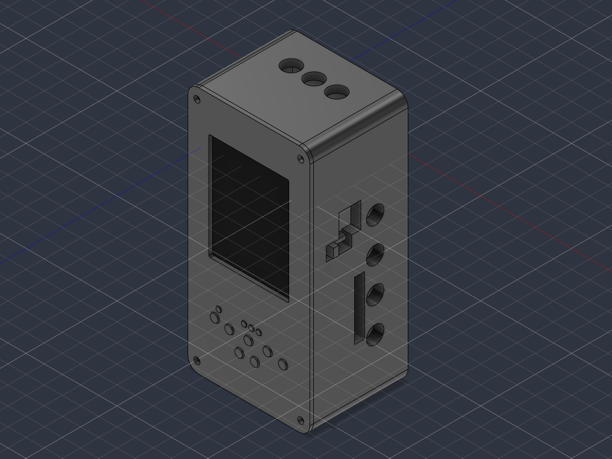
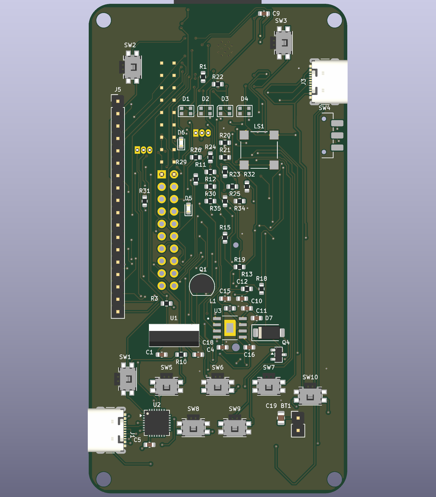
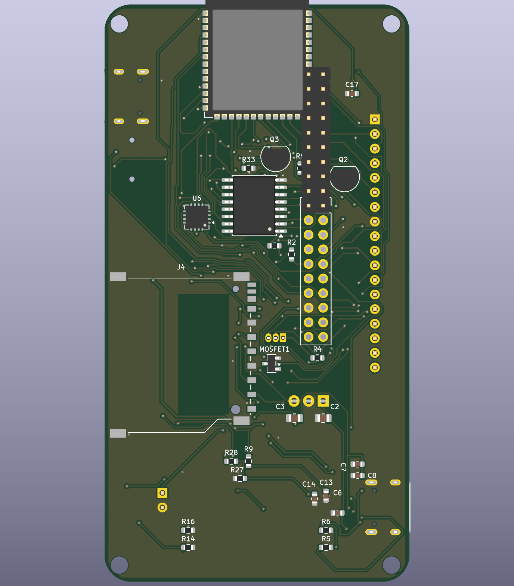
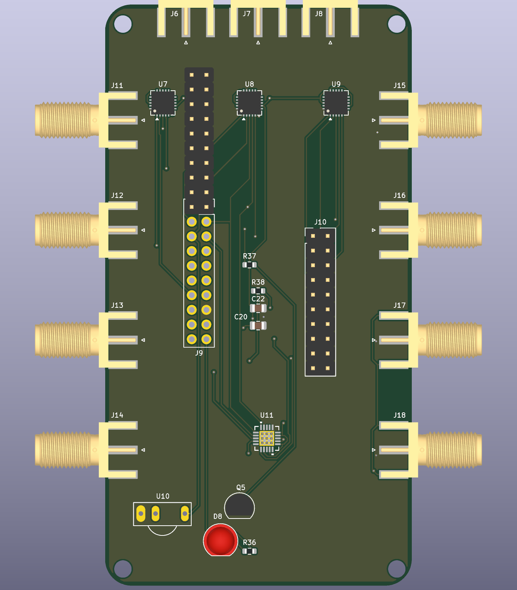
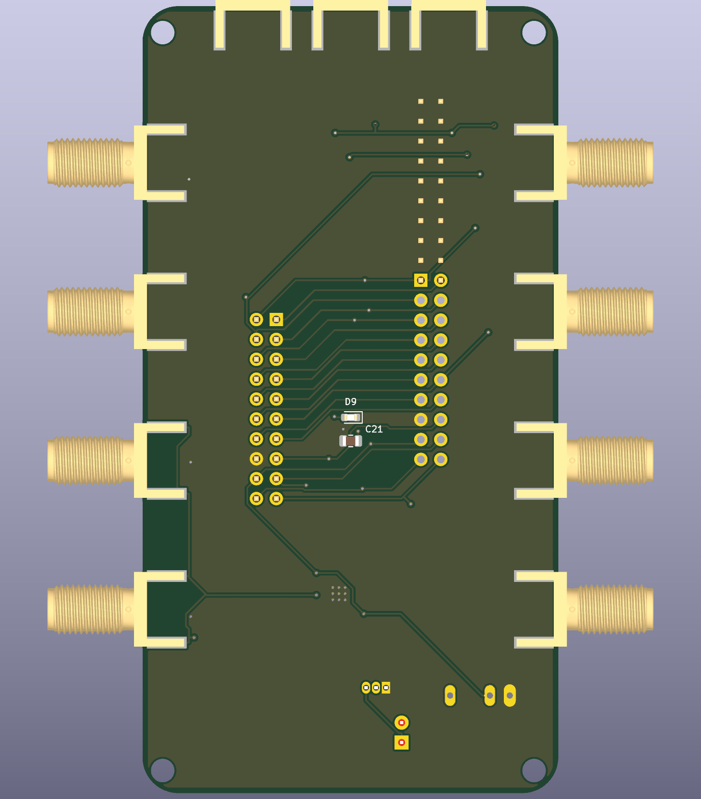
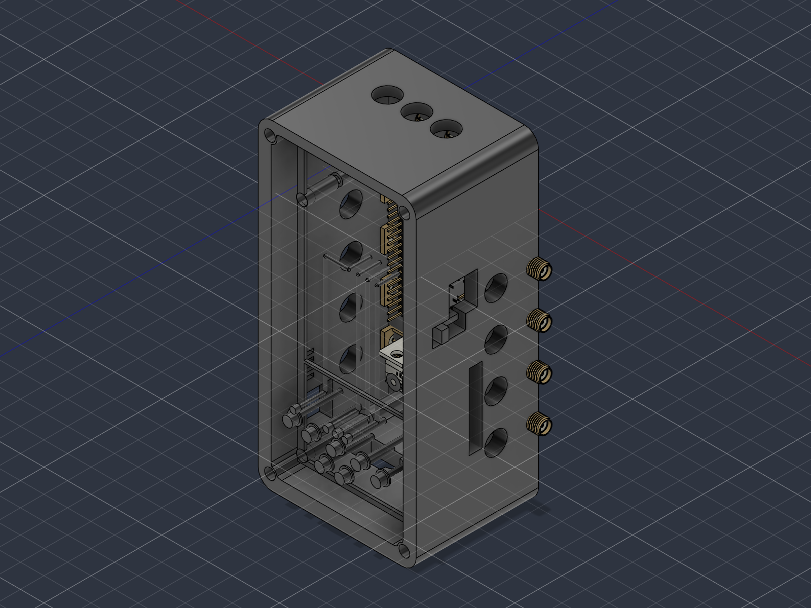

# Jammer

Jammer is my custom handheld electronics project, built around an **ESP32-S3-WROOM-1-N16** with a main board, a separate shield and a custom enclosure.

so basically i wanted to make a handheld device with its own screen, buttons, battery and a proper case, but i also wanted to go further than just connecting a bunch of ready-made modules together.. custom schematics, a stacked PCB design, touch display, storage, infrared, status feedback and the firmware side too. i designed the electronics in KiCad and worked on the enclosure in Fusion 360, which turned into a much bigger rabbit hole than expected lol

## why i made this

i wanted to build something where i could work on the whole thing from scratch instead of only doing one small part of it.. the circuit, board layout, case, controls and the parts list all had to fit together into one handheld project

main goals :

- make the schematic section by section in KiCad
- design a main board and a separate shield that fit together as a stack
- include a 2.8-inch SPI touch display and six front buttons
- include USB-C connections and a USB-to-UART interface for development
- add storage, infrared and visual feedback to the design
- plan the battery and power sections around a portable device
- work through PCB placement and routing instead of stopping at the schematic
- design a custom enclosure in Fusion 360
- keep the project files, production references, images and BOM together so the work is easier to understand and build on

the fun part is that everything affects everything else.. changing a connector position can affect the routing and the case opening, while changing the display arrangement can affect the buttons, internal space and cable clearance. thats the kind of detail that makes a handheld project way more involved than it looks from the outside

whats in this repo :

- `CAD/` — exported assembly models and printing files
- `BOM Images/` — supplier and component sourcing screenshots
- `Firmware/` — MicroPython application files and the bundled runtime image
- `FusionFiles/` — editable Fusion 360 design file
- `Images/` — PCB, schematic and enclosure screenshots
- `PCB/` — KiCad projects, libraries, audit material and the separate engineering revision
- `PDFs/` — exported schematic and layout PDFs
- `Production/` — Gerber archives, placement information, BOM and netlist exports
- `bom.csv` — sourcing list, supplier links and captured costs

## hardware summary

| | |
|---|---|
| Project | Jammer |
| Format | Custom handheld device with stacked main and shield boards |
| Controller listed in BOM | ESP32-S3-WROOM-1-N16 |
| Display | Robu 62026 2.8-inch SPI touch display |
| Front controls | Six buttons shown in the project design |
| USB | Two USB-C receptacles listed in the BOM |
| Development interface | CP2102N USB-to-UART section |
| Button interface in earlier design | PCF8574 I/O expander |
| Storage | SD card socket included in the design |
| Infrared | IR emitter and receiver parts included in the project |
| Feedback | Status LEDs, addressable RGB and a buzzer section |
| Radio parts in the supplied design material | nRF24L01-family and CC1101 parts with external connector provisions |
| Power | Battery, charging and supply sections with revision-specific parts |
| PCB | Main board and shield, with four-layer fabrication files in the revised engineering package |
| CAD | Fusion 360 and exported 3D files |
| Firmware | MicroPython source with hardware limitations documented in the files |

some of the interesting work is hidden inside the enclosure.. the boards need to fit together, the display needs its own space and support, and the controls and connectors need to line up with the outside of the case. the CAD and PCB images below show the project from a few different angles

## images

### main PCB

### PCB routing and board layers

### shield PCB

### schematic

i worked on the schematic in smaller sections first, then brought those sections together before moving into the PCB layout. the screenshots include the controller, power, connectors, display, controls and supporting circuits from the supplied design material

### CAD and case

these are design screenshots and renders, so they show the intended arrangement rather than a finished physical assembly. some schematic images also show earlier revisions and should be read alongside the current files

## repo file checklist

the main project folder names are:

- `PCB/` — KiCad design files and engineering references
- `CAD/` — assembly exports and printing files
- `FusionFiles/` — editable Fusion design
- `Firmware/` — MicroPython source and runtime files
- `Production/` — manufacturing outputs
- `PDFs/` — schematic and layout exports
- `Images/` — project screenshots used in this README
- `BOM Images/` — sourcing screenshots
- `bom.csv` — captured sourcing list

the exact filenames inside each folder may change as the project gets updated, so open the folders to find the relevant versions. check the revision before combining a schematic, board, firmware file or parts list from different places

## cad

the case was designed in Fusion 360. [`FusionFiles/Jammer V1.f3d`](FusionFiles/Jammer%20V1.f3d) is the editable design, while `CAD/` contains the exported assembly and printing material. check the available files and formats before preparing a print or manufacturing order

the case and PCB need to be checked together before fabrication: board mounting, screen support, connector access, button alignment and space for the battery and cables all matter. something looking clear in the outside render doesnt automatically mean the internal assembly fits properly

the internal CAD view is useful for seeing how the parts are intended to sit together, but the actual display module, connector tolerances and battery clearance still need a physical fit check

## firmware note

the project includes a `Firmware/` folder with MicroPython files for the application, hardware interfaces, display, storage, infrared and radio-related code. it also includes an ESP32-S3 MicroPython runtime image and its provenance information

the application source includes menu and device-status handling, touch calibration, storage/logging support and interface-related functions. these are source-level features and still need to be checked on the actual hardware

the top-level `hardware.py` explicitly sets `RADIOS_AVAILABLE = False`. it also holds some conflicting functions inactive instead of pretending they are usable, so the presence of a menu item or driver file isnt proof that the matching hardware feature is ready

firmware configuration and flashing details should be confirmed against the actual files and the matching schematic revision before building. i dont want to claim a particular image, pin assignment or feature is ready until it has been checked against the board it is meant to run on

## bom

the sourcing bill of materials is in [`bom.csv`](bom.csv). it includes the item name, quantity, supplier link, distributor and total line cost in US dollars.
**listed BOM total: $459.58 USD**

a few notable parts from the BOM:

| Part | Purpose |
|---|---|
| ESP32-S3-WROOM-1-N16 | Main controller |
| Robu 62026 touch display | Screen and touch interface |
| CP2102N-A02-GQFN28R | USB-to-UART interface |
| PCF8574T | I/O expansion in the earlier design |
| TE Connectivity 2041021-3 | SD card socket |
| GCT USB4105-GF-A | USB-C receptacles |
| WS2812B-2020-V6 | Addressable RGB indicators |
| CMT-7525-80-SMT-TR | Buzzer listed in the sourcing list |
| TSAL6200 and TSOP1738 | Infrared-related parts |
| nRF24L01 and CC1101 parts | Radio hardware represented in the supplied design material |
| Main and shield PCB fabrication | Separate board orders listed in the CSV |
| Printed enclosure and mounting hardware | Case and assembly parts |

